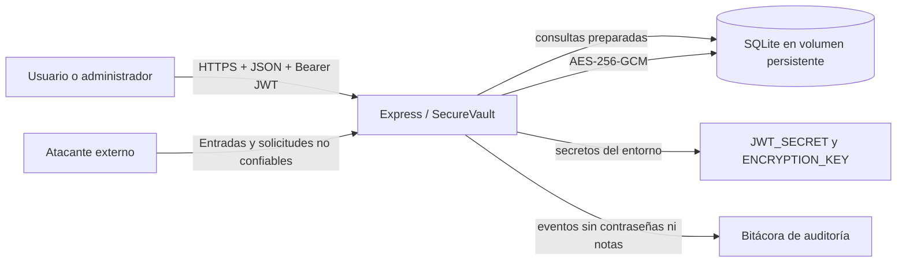

# Informe de seguridad: SecureVault

> **Estado:** borrador de entrega. El código incorpora controles descritos abajo, pero las pruebas en ejecución, capturas, escaneos, URL pública y resultados de dependencias deben completarse con el servidor del equipo. No marcar una evidencia como aprobada sin ejecutarla y guardar su resultado.

## Alcance y modelo de amenazas

SecureVault es una API REST de notas privadas con registro, login, perfil, rol administrador y bitácora. Los activos principales son contraseñas, tokens de sesión, notas, teléfono, roles y eventos. Se considera que una persona puede enviar entradas malformadas, probar contraseñas, cambiar IDs de ruta o manipular sus propias solicitudes. La aplicación no acepta una URL remota del usuario ni ejecuta archivos suministrados por el usuario.

| Amenaza STRIDE | Ejemplo | Medida en el proyecto | Riesgo restante |
| --- | --- | --- | --- |
| Suplantación | Robo o fuerza bruta de contraseña/JWT | bcrypt cost 12; JWT HS256 de 15 min; revocación por `jti`; límite de login | Sin MFA; usar HTTPS y guardar el token fuera de logs/localStorage público |
| Manipulación | Cambiar el ID de una nota o alterar contenido cifrado | Cada consulta de nota limita por `owner_id`; AES-GCM detecta manipulación | Una llave comprometida permite descifrar datos |
| Repudio | Negar un cambio de rol o login | Eventos de auditoría asociados al ID de usuario | La base local no es bitácora inmutable ni alerta externa |
| Divulgación | Leer notas de otra cuenta o inspeccionar la base | Respuesta requiere token y propietario; notas/teléfono cifrados; perfil enmascara teléfono | La API descifra para el propietario y el proceso necesita la llave |
| Denegación de servicio | Abusar login, cuerpo grande o crear notas sin límite | Rate limit, JSON máximo 10 KB, 100 notas por cuenta, contenido máximo 5000 caracteres | Rate limits están en memoria y no coordinan varias instancias |
| Elevación de privilegios | Cambiar rol desde campos de registro | Registro no acepta rol; rutas admin consultan rol actual en DB; último admin protegido | Acceso de administrador debe protegerse y revisarse periódicamente |

## Mapeo OWASP Top 10:2025

| Categoría | Mitigación implementada | Evidencia que debe guardarse |
| --- | --- | --- |
| A01 Broken Access Control | Middleware de sesión/rol; SQL con `id` y `owner_id`; el rol vive en el servidor. No hay fetch/URL controlada por usuario, reduciendo SSRF. | Con dos usuarios propios, el usuario B intenta leer, editar y borrar una nota de A: respuesta esperada 404. Captura de request/response. |
| A02 Security Misconfiguration | Helmet/CSP/HSTS, oculta `X-Powered-By`, errores JSON genéricos, `NODE_ENV=production`; trust proxy apagado por defecto y configurable. | Encabezados de la URL de producción y reporte Mozilla Observatory o SecurityHeaders. Revisar que no se exponga stack trace. |
| A03 Software Supply Chain Failures | `package-lock.json`, `npm ci`, `npm audit --audit-level=high`, Dependabot semanal y permisos `contents: read` en CI. | Ejecución de Actions verde y salida completa de `npm audit`; si reporta vulnerabilidades, actualizar y volver a revisar. |
| A04 Cryptographic Failures | bcrypt para contraseñas; AES-256-GCM, IV de 12 bytes y tag de autenticación para notas/teléfono; claves no versionadas; HTTPS en producción. | Mostrar hash bcrypt en DB; ciphertext/IV/tag de una nota en DB; captura de certificado TLS. No mostrar valores de claves. |
| A05 Injection (incluye XSS) | Express Validator, JSON limitado, consultas SQLite preparadas; la API devuelve JSON y la interfaz construye contenido del usuario con `textContent`. CSP limita recursos del mismo origen. | Entrada de correo inválida rechazada; cadena tipo SQLi no modifica consultas. Verificar que ``. La API no debe ejecutarlo; confirmar que el ciphertext no contiene el texto legible en SQLite. No usar datos reales.
6. Solicitar recuperación en desarrollo, usar el token solo una vez y comprobar rechazo en el segundo uso. En producción, este paso requiere webhook de entrega HTTPS configurado.
7. Revisar encabezados/TLS con SecurityHeaders o Mozilla Observatory, SSL Labs y OWASP ZAP. Apuntar fecha, URL y resultado. No escanear sitios ajenos.

| Evidencia final | Resultado del equipo |
| --- | --- |
| URL HTTPS publicada y fecha de verificación | Pendiente de despliegue |
| `npm audit --audit-level=high` | Pendiente de ejecución |
| CI de GitHub Actions | Pendiente de publicar el repositorio |
| OWASP ZAP | Pendiente de ejecutar en la URL propia |
| SSL Labs / SecurityHeaders | Pendiente de URL pública |
| Capturas de IDOR, 429, cifrado y sesión | Pendiente de ejecutar |

## Decisiones criptográficas y riesgos residuales

Una contraseña debe validarse, no recuperarse; por eso se almacena con bcrypt y sal, mientras que la nota sí se cifra porque el dueño debe volver a leerla. AES-GCM proporciona confidencialidad e integridad con una llave de 256 bits y un IV aleatorio por valor cifrado. El tag se valida al descifrar. La llave productiva se configura aparte de `JWT_SECRET` mediante el gestor de secretos de la plataforma. No rotar la llave sin un procedimiento de descifrado y recifrado; el código actual no automatiza esa rotación.

SQLite y el rate limit en memoria son decisiones de escala para la práctica, no para un servicio multi-instancia. El proceso necesita una sola instancia y un volumen persistente; el equipo debe comprobar respaldos y recuperación. El endpoint de recuperación solo entrega tokens cuando existe un webhook configurado en producción; hace falta integrar un proveedor de correo real antes de uso público. No hay MFA, alertas externas ni bloqueo por cuenta. Las credenciales de prueba deben ser ficticias y compartirse con el docente por un canal privado, nunca en este informe o el README.
